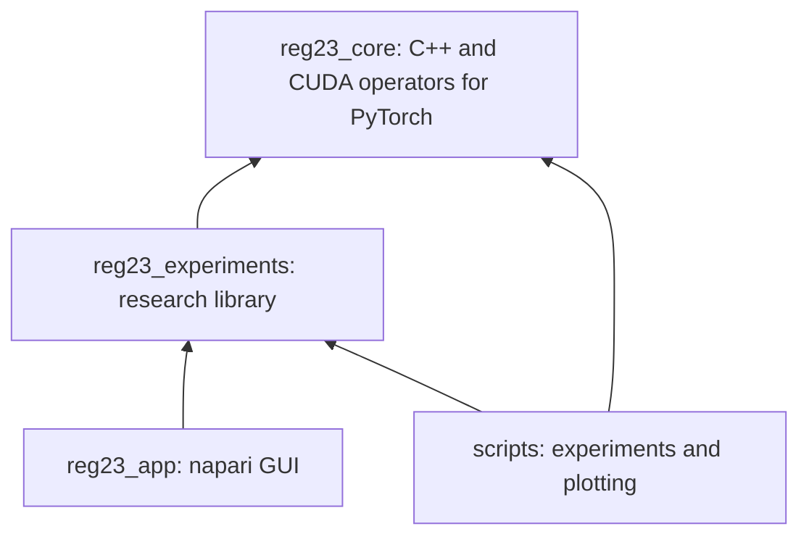
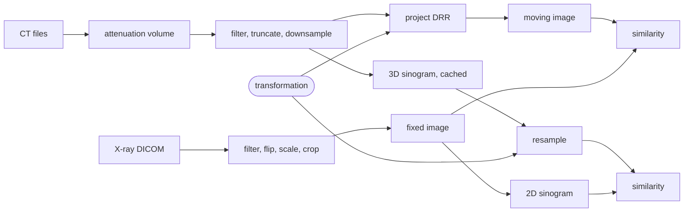

# Architecture

## Packages

Arrows point to dependencies. `reg23_core` depends only on PyTorch. The app and the scripts do not depend on each other, but
share the registration pipelines in `reg23_experiments.experiments` and the annotations in [data/](../data/README.md).

## The problem

Given a CT volume and an X-ray, find the rigid transformation of the CT at which its projection matches the X-ray. The
detector lies in the plane z = 0 of world space, with the source at distance `source_distance` along z. The transformation
places the CT in that space. The full conventions are [here](../packages/reg23_core/Conventions.md).

## From files to a similarity

The upper route compares images. The lower route compares sinograms, using Grangeat's relation. The optimiser changes only the
transformation, so everything upstream of it is evaluated once.

This is implemented as a [data graph](../packages/reg23_experiments/src/reg23_experiments/ops/data_manager/package_documentation.md)
in which each image is a node, and functions called *updaters* compute nodes from other nodes. Setting a parameter marks
everything that depends on it as out of date, and reading a node brings it up to date. The app and the experiments add the
same updaters to their graphs: the app uses the versions for a single transformation, and the experiments use the batched
versions.

## Optimisation

Optimisers minimise the negated similarity over a scaled 6-vector of parameters, so that a unit step has a similar effect in
each direction. Particle swarm optimisation, in `ops.swarm`, is used throughout.

## Truncated CT

When the CT covers only part of the anatomy, some rays pass through anatomy that the DRR cannot include. The *cuboid mask*
gives the fraction of each ray that the CT covers. It is used to choose the crop, and to weight pixels in the similarity.

## Tensor conventions

| Quantity               | Order / type                                     |
|------------------------|--------------------------------------------------|
| Volume data            | (z, y, x), `float32`                             |
| Image data             | (y, x), `float32`                                |
| Spacing, positions     | (x, y) or (x, y, z) in mm, `float64`             |
| Transformations        | axis-angle in radians, translation in mm, `float64` |
| Batches                | leading dimensions                               |

Note that sizes and spacings have opposite orders, so one must be flipped before they are multiplied.

## Errors

Expected failures are returned as `Error` values rather than raised, throughout `reg23_experiments`.
