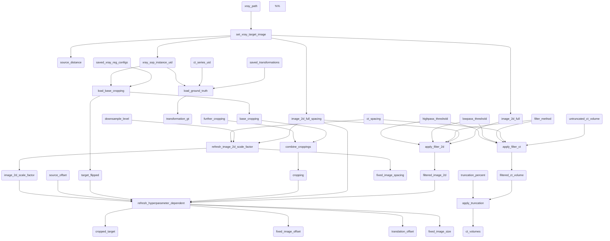
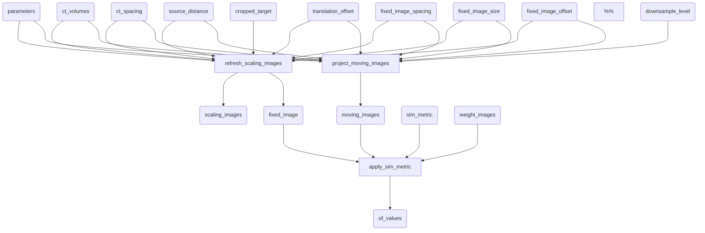
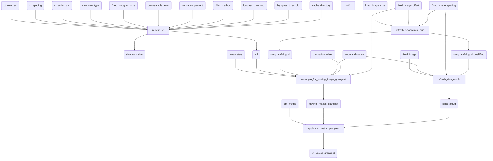

The registration accuracy experiment: repeat a registration from random starting positions around a gold standard, and
record how the distance from the gold standard falls as the optimisation proceeds.

## Contents

| Module                       | Purpose                                                                                     |
|------------------------------|---------------------------------------------------------------------------------------------|
| `_reg_experiment`            | `ExperimentParametrisation` and the `reg_experiment` function                               |
| `_init_dadg`                 | Loads the CT and fills the data graph with initial values and updaters                      |
| `_setup`                     | Loads the saved transformations and X-ray configurations                                    |
| `_of_together`               | Objective functions that do not go through the graph, including the fused CUDA operator     |
| `_dadg_updaters.drr_reg`     | Loading, filtering, truncation and cropping: the part shared by every approach              |
| `_dadg_updaters.batched`     | Moving images and similarities for a batch of parameter vectors; used by experiments        |
| `_dadg_updaters.unbatched`   | The same for a single transformation, plus projected fiducials; used by the app             |
| `_dadg_updaters.grangeat`    | Sinograms, and unbatched Grangeat moving images and similarity                              |

## How a run works

1. The script builds an `ExperimentSetConfig` and calls `init_dadg`. This loads the CT, and adds updaters for either X-ray or
   synthetic target images.
2. `reg_experiment` is called for each configuration. It sets the graph nodes that the configuration controls, using equality
   checks so that unchanged inputs do not trigger reloading or recomputation.
3. Cropping and weighting are either updated on every objective function evaluation, by adding an updater, or every N
   iterations, as periodic behaviours of the registration.
4. For each repetition, a starting transformation is drawn at `starting_distance` from the gold standard and passed to
   `reg23_experiments.experiments.registration.register`.
5. The mean and standard deviation of the distance over the repetitions are returned for each iteration.

The objective function sets the `parameters` node to a batch of parameter vectors and reads `of_values`, or
`of_values_grangeat` if `grangeat` is set. Updating the cropping on every evaluation requires a batch size of 1.

## Options

| Option                         | Effect                                                                                   |
|--------------------------------|------------------------------------------------------------------------------------------|
| `downsample_level`             | Level of the CT pyramid; the X-ray is scaled to match                                    |
| `truncation_percent`           | How much of the CT to remove, split evenly between the top and bottom                    |
| `cropping_method`              | None, the projected bounds of the CT, or only rays through the full depth of the CT      |
| `weighting_method`, `weight_alpha` | How the scaling image is converted into similarity weights                           |
| `sim_metric`                   | Similarity metric, by name                                                               |
| `filter_method` and thresholds | Frequency filtering, applied equally to the CT and X-ray                                 |
| `iterations_per_..._update`    | Update interval for cropping and weighting; 0 means every evaluation                     |

## Data graph

The graphs below show the updaters added by `init_dadg` for X-ray targets. Rectangles name updaters, and the rest are nodes.
Nodes with no incoming arrow are set directly. `further_cropping` and `weight_images` are written either by an updater or
by a periodic behaviour.

### Shared by both approaches

### DRR-based registration

### Grangeat-based registration

